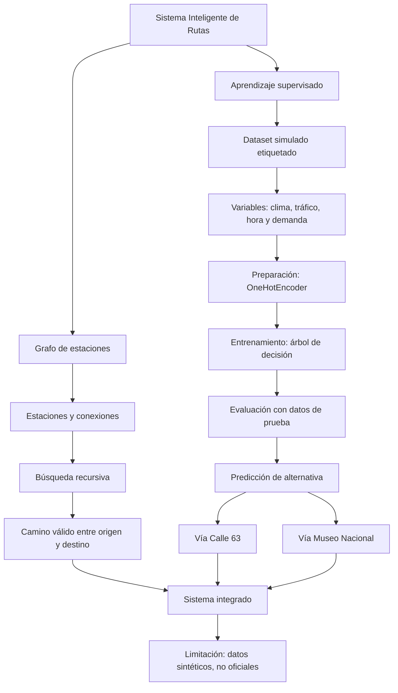

# Mapa conceptual — Sistema Inteligente de Rutas

Copia este bloque en un visor compatible con Mermaid (por ejemplo, Mermaid Live Editor) para visualizarlo, o consérvalo como mapa conceptual dentro del repositorio.

## Explicación
El grafo representa las estaciones y sus conexiones. La búsqueda recursiva encuentra un camino entre estaciones. Para el tramo Calle 72 → Centro, el clasificador supervisado aprende de ejemplos etiquetados y recomienda una de dos alternativas usando las condiciones del viaje. Ambos componentes se integran en un solo programa.
